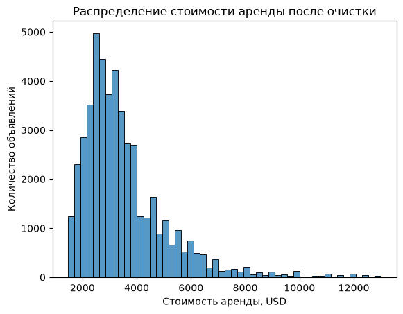
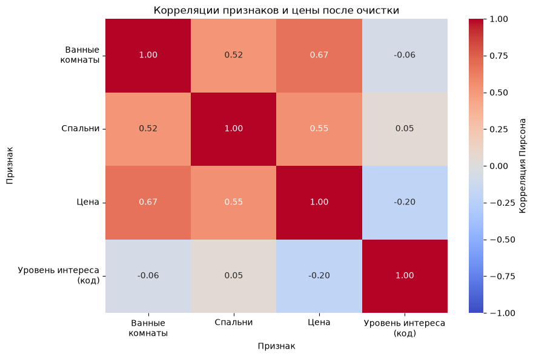

# Apartment Rental Price Prediction

Исследование стоимости аренды квартир на данных RentHop. Проект охватывает первичный анализ данных, обработку выбросов, создание признаков и сравнение четырёх подходов к прогнозированию цены.

**Главный результат:** дерево решений показало MAE **759,76 USD** на тестовой выборке. Это примерно на **29,9% меньше**, чем у постоянного прогноза по медиане. Эксперимент также показал, как полином степени 10 становится неустойчивым при выходе за диапазон обучающих данных.

[Открыть исследование в Jupyter Notebook](src/ml_introduction.ipynb) · [Источник данных](https://www.kaggle.com/competitions/two-sigma-connect-rental-listing-inquiries/data)

**Стек:** Python · pandas · NumPy · scikit-learn · Matplotlib · Seaborn

Учебный проект выполнен в рамках вводного курса машинного обучения School 21. Фокус работы: корректное сравнение моделей, воспроизводимость и объяснение результатов.

## Результаты

Все подходы оценены на одинаковых обучающей и тестовой выборках. Обе метрики выражены в USD; меньшее значение соответствует меньшей ошибке.

| Подход | MAE, train | MAE, test | RMSE, train | RMSE, test |
|---|---:|---:|---:|---:|
| **Дерево решений** | **756,04** | **759,76** | **1 077,48** | **1 081,75** |
| Прогноз по медиане | 1 086,21 | 1 084,59 | 1 644,24 | 1 635,40 |
| Прогноз по среднему | 1 139,19 | 1 137,83 | 1 597,65 | 1 590,39 |
| Линейная регрессия + полином степени 10 | 855,15 | 9,20 × 10¹³ | 1 218,49 | 2,49 × 10¹⁶ |

Дерево оказалось лучшим из четырёх исследованных подходов по обеим тестовым метрикам:

- MAE ниже на **29,9%** относительно медианного прогноза, лучшего постоянного подхода по MAE;
- RMSE ниже на **32,0%** относительно прогноза по среднему, лучшего постоянного подхода по RMSE;
- ошибки дерева на train и test близки: на исследованных данных большого разрыва между выборками не наблюдается.

Среднее и медиана служат базовыми ориентирами. Медиана лучше справилась с абсолютной ошибкой, среднее с квадратичной. Это помогает оценить, какую пользу даёт использование признаков квартиры.

## Данные и постановка задачи

Источник данных: объявления об аренде квартир в Нью-Йорке из соревнования [Two Sigma Connect: Rental Listing Inquiries](https://www.kaggle.com/competitions/two-sigma-connect-rental-listing-inquiries/data).

В исходном соревновании целевой переменной был уровень интереса к объявлению. В этом учебном исследовании задача изменена: предсказывается **`price`, стоимость аренды**. Поэтому работа представляет собой отдельный эксперимент по регрессии цены.

| Выборка | Исходное число объявлений | После очистки цены |
|---|---:|---:|
| `train.json` | 49 352 | 48 379 |
| `test.json` | 74 659 | 73 255 |

Файлы не пересекаются по `listing_id`. В исходных данных train содержит 15 столбцов, test 14. В тестовом файле отсутствует `interest_level`, но есть цена и оба признака, необходимые для регрессии.

Для обучения по условию проекта используются только:

| Признак | Описание |
|---|---|
| `bathrooms` | Количество ванных комнат |
| `bedrooms` | Количество спален |

`interest_level` исследуется на этапе анализа и создания признаков. В обучение моделей он не входит.

Для локального анализа использована публичная копия `train.json` из [материалов mlcourse.ai](https://mlcourse.ai/book/topic06/topic6_feature_engineering_feature_selection.html). Файл `test.json` загружен с Kaggle.

## Ход исследования

### 1. Первичный анализ и очистка

Проверены структура таблицы, типы данных, пропуски и основные статистики. В исходном train цена достигает **4 490 000 USD** при медиане **3 150 USD**, поэтому начальная гистограмма почти не показывает основную часть распределения.

По обучающей выборке рассчитаны 1-й и 99-й процентили цены. Сохранены объявления с ценами **от 1 475 до 13 000 USD включительно**. Те же границы применены к тестовым ценам.

После фильтрации удалено 973 обучающих и 1 404 тестовых объявления. Распределение остаётся асимметричным, с длинным правым хвостом.



Эта фильтрация задаёт область оценки: итоговые метрики относятся к указанному диапазону аренды.

### 2. Анализ признаков и взаимосвязей

Построены гистограммы количества комнат, boxplot цены, корреляционная матрица и три диаграммы рассеяния. Уровень интереса закодирован по порядку: `low = 0`, `medium = 1`, `high = 2`.

После исключения крайних цен линейная связь признаков с ценой стала заметно сильнее:

| Пара признаков | До очистки | После очистки |
|---|---:|---:|
| Цена и ванные комнаты | 0,070 | 0,672 |
| Цена и спальни | 0,052 | 0,546 |



При этом диапазоны цен для квартир с одинаковым числом комнат сильно перекрываются. Одних этих характеристик недостаточно для однозначного определения стоимости.

### 3. Создание признаков

В исследовательской части созданы квадраты количества спален, ванных комнат и кода уровня интереса. Во всех трёх случаях абсолютная величина корреляции с ценой немного уменьшилась.

Для обучения применён `PolynomialFeatures(degree=10)` к двум исходным признакам. Получено **66 столбцов**, включая константу, степени и произведения признаков. Преобразование настроено через `fit_transform` на train и применено через `transform` к test.

### 4. Обучение и сравнение

Сравнены четыре подхода:

| Подход | Настройка |
|---|---|
| `LinearRegression` | Стандартные параметры, полиномиальные признаки степени 10 |
| `DecisionTreeRegressor` | `random_state=21`, те же полиномиальные признаки |
| `naive_mean` | Постоянный прогноз по среднему `y_train` |
| `naive_median` | Постоянный прогноз по медиане `y_train` |

Для обеих наивных моделей константы вычислены только по обучающим ценам и затем использованы на обеих выборках. Подбор гиперпараметров не проводился; степень полинома и набор моделей заданы учебным проектом.

## Почему линейная регрессия дала огромную ошибку

В тестовой выборке обнаружены три объявления с **20, 112 и 20 ванными комнатами**. Максимальное значение этого признака в очищенном train равно 10.

Для объявления с 112 ванными комнатами и реальной ценой **3 700 USD** линейная модель на полиномиальных признаках предсказала около **6,74 × 10¹⁸ USD**. Почти вся её абсолютная ошибка на test приходится на эти три наблюдения.

Высокие степени признаков приводят к крайне большим значениям при выходе за обучающий диапазон. Полученная модель оказалась неустойчивой к такой экстраполяции. Дерево выдаёт среднюю обучающую цену в соответствующем листе, поэтому его прогнозы остаются в пределах обучающих цен.

В основном эксперименте эти записи сохранены. Все четыре подхода сравниваются на одной тестовой выборке, включая необычные объявления.

## Ограничения и выводы

- Используются только два исходных признака. Площадь, местоположение, описание и фотографии в моделях не учитываются.
- Оценка ограничена ценами 1 475-13 000 USD. Результаты нельзя напрямую переносить на весь исходный диапазон аренды.
- Наивные прогнозы показывают, что использование характеристик квартиры даёт измеримое улучшение относительно одной фиксированной цены.
- Усложнение признаков не гарантирует улучшения: полином степени 10 оказался чувствительным к необычным тестовым значениям.
- Сравнение фиксированного набора моделей проведено на отдельных файлах train/test. Валидационная выборка и кросс-валидация в рамках задания не использовались. Для дальнейшего выбора и настройки моделей потребовалась бы отдельная валидация.

Основной результат проекта: дерево решений лучше справилось с исследованной задачей, а анализ ошибок позволил объяснить провал более сложной полиномиальной модели.

## Воспроизведение

Проверено на **Python 3.14.7**. Версии библиотек, использованные в исследовании, перечислены в [requirements.txt](requirements.txt). В ноутбуке сохранены результаты вычислений и графики; проверено последовательное выполнение 51 Code-ячейки в чистой сессии без ошибок.

### Окружение

Команды для macOS и Linux выполняются из корня репозитория:

```bash
python3 -m venv .venv
source .venv/bin/activate
python -m pip install -r requirements.txt
```

Если на macOS импорт LightGBM сообщает об отсутствии `libomp.dylib`, установите системную библиотеку OpenMP:

```bash
brew install libomp
```

### Подготовка данных

Скачайте `train.json.zip` и `test.json.zip` со [страницы данных Kaggle](https://www.kaggle.com/competitions/two-sigma-connect-rental-listing-inquiries/data), распакуйте и разместите JSON-файлы в `src/data/`. Для запуска нужны только эти два файла.

### Запуск ноутбука

В VS Code откройте [src/ml_introduction.ipynb](src/ml_introduction.ipynb), выберите созданное окружение Python и выполните **Run All**. Рабочая папка ядра должна быть `src`, поскольку в ноутбуке используются пути `./data/train.json` и `./data/test.json`.

Также можно запустить JupyterLab:

```bash
python -m pip install jupyterlab
cd src
python -m jupyterlab ml_introduction.ipynb
```

## Структура проекта

```text
.
├── README.md
├── requirements.txt
├── docs/
│   └── images/
│       ├── price_distribution.png
│       └── correlation_matrix.png
└── src/
    ├── ml_introduction.ipynb
    └── data/
        ├── train.json
        └── test.json
```

Все этапы анализа, код моделей, расчёт метрик и подробные пояснения собраны в [основном ноутбуке](src/ml_introduction.ipynb).
